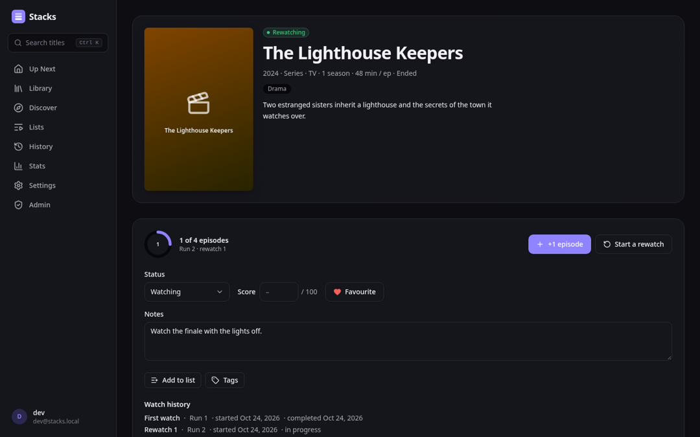
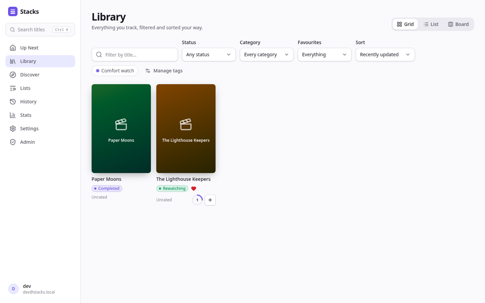
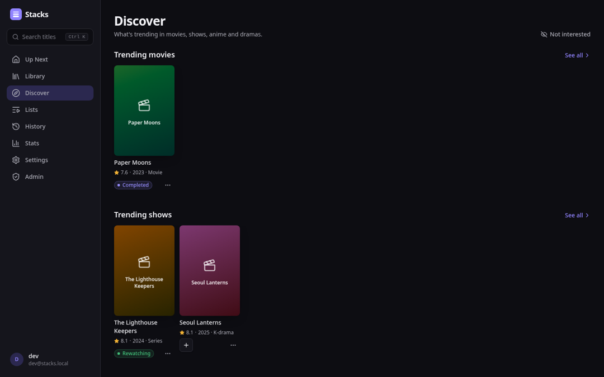
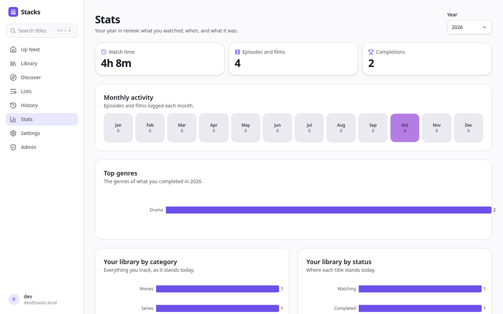

# Stacks

A self-hosted tracker for everything you watch: movies, TV, anime and Asian
dramas. Log episodes with one tap, rewatch without losing the first run,
score in the format you like, organise with lists and tags, and see your year
in review. Your history lives in your own PostgreSQL database, and a Stacks
backup gives all of it back, row for row.



| | |
| --- | --- |
|  |  |
|  | |

## What it does

- **Track anything.** Search TMDB and AniList at once from the ⌘K palette.
  Titles are categorised as movies, series, anime, K-, J-, C-, TW- and Thai
  dramas. Status, a score in your format (100-point, 10-point with or
  without decimals, 5-point or three faces), favourites and notes.
- **Episodes and rewatches.** "+1 episode", "mark up to here", a seasons grid,
  Up Next and a calendar of what airs. A rewatch starts a new run; the first
  one, and every play in it, is kept.
- **Never lose data.** Plays and changes are append-only and undoable from
  the history feed; deletes go to a trash you can restore from. The library
  is served from a local snapshot of each title, so it keeps working when
  TMDB or AniList is down.
- **Organise.** Lists you reorder by dragging, tags, a blocklist that keeps
  titles out of suggestions, and Discover rails for every category.
- **Bring your history.** Import MyAnimeList (XML or JSON) and TMDB exports,
  with a screen to resolve low-confidence matches. Export a lossless Stacks
  backup (JSON) or CSV.
- **Yours to run.** OpenID Connect sign-in with your own provider, API tokens
  with scopes for scripts, webhook and Apprise notifications, Prometheus
  metrics, signed and attested release images.

## Quick start (release bundle)

You need Docker Compose v2, or Podman with Docker Compose as its provider
([supported providers](docs/DEPLOY.md#compose-providers)), an OpenID Connect provider
(Authelia, Authentik, Keycloak, …) and a TMDB API key (a v3 key or a v4 read
access token, from <https://www.themoviedb.org/settings/api>).

Each GitHub Release attaches `stacks-compose-vX.Y.Z.tar.gz`: the compose
files, the Dex and backup helpers, `.env.example`, this README and the
deployment guide.

```bash
gh release download v0.1.0 -R justin13888/Stacks -p 'stacks-compose-*.tar.gz'
tar -xzf stacks-compose-v0.1.0.tar.gz && cd stacks-compose-v0.1.0
cp .env.example .env && $EDITOR .env    # see Configuration below
echo STACKS_VERSION=v0.1.0 >> .env      # pin the release; the default is latest
docker compose up -d                    # or: docker compose --profile backup up -d (daily pg_dump)
```

Open <http://localhost:3000> (or your reverse proxy's address) and sign in.
[`docs/DEPLOY.md`](docs/DEPLOY.md) covers TLS, the reverse proxy, your
identity provider, backups and restores, upgrades, and verifying the images.

To try it without an identity provider, add `--profile dev-idp`: it starts a
throwaway Dex with two accounts, `dev@stacks.local` and `friend@stacks.local`
(password `password`), and needs `WW_OIDC_ISSUER=http://localhost:5556/dex`,
`WW_OIDC_INTERNAL_ISSUER=http://dex:5556/dex`, `WW_OIDC_CLIENT_ID=stacks`
and `WW_OIDC_CLIENT_SECRET=stacks-dev-client-secret`. Never expose it.

## Development quick start

Prerequisites: Podman or Docker with a [supported compose
provider](docs/DEPLOY.md#compose-providers), [`just`](https://github.com/casey/just),
[Bun](https://bun.sh), the Rust toolchain pinned in `rust-toolchain.toml`, and
a TMDB key.

```bash
just setup            # writes api/.env from api/.env.example
$EDITOR api/.env      # set WW_TMDB_API_KEY
just up               # builds the images from this checkout; Postgres + Dex + API + web
```

Open <http://localhost:3000> and sign in as `dev@stacks.local` / `password`
(an admin, through `WW_ADMIN_EMAILS`).

| Service | Address |
| --- | --- |
| Web app | <http://localhost:3000> |
| API | <http://127.0.0.1:8095> (reference at `/api/docs`) |
| Metrics | <http://127.0.0.1:9095/metrics> |
| Dex | <http://localhost:5556/dex> (loopback only) |
| PostgreSQL | `127.0.0.1:5432` (`stacks` / `stacks`) |

`just logs [service]`, `just down` and `just nuke` (deletes the volumes)
manage it. For an edit-reload loop, run the database in a container and the
API and web app on the host:

```bash
just dev-up           # PostgreSQL only
just dev-api          # API on :8095, reading api/.env
just dev-web          # Vite on :3000, proxying /api
```

Every command is a recipe in the [`Justfile`](Justfile) (`just --list`).
`just check` is the gate CI and the pre-push hook run; it needs
`bun install` in `web/`, `web/contract/` and `e2e/` first. The browser suite
runs against the composed stack:

```bash
just e2e-install      # Playwright and Chromium, once
just e2e-up           # the stack with Dex and metadata fixtures
just e2e              # journey, screenshots, outage drills
just e2e-down
```

[`docs/QA.md`](docs/QA.md) is the manual QA runbook for a release.

## Architecture

```
api/         stacks-api: the kynos HTTP server; its OpenAPI 3.1 document is
             derived from the router and committed as web/openapi.json
core/        stacks-core: domain services, SeaORM entities, the metadata
             provider over cameo, the job runner, import/export
core/migration/  the schema (one baseline for v0.1.0; append-only after)
web/         Bun + Vite + React 19 + TanStack Router/Query; the client is
             generated by orval from web/openapi.json
tests/e2e/   a Rust client spargen generates from web/openapi.json
e2e/         the Playwright suite against the composed stack
deploy/      Dex config for development, backup scripts
docs/        deployment, QA, the backup format, decision records (docs/adr)
```

The web container's nginx serves the app and proxies `/api` to the API, so
the browser talks to one origin. The API runs migrations on start, serves
`/api/v1` and the probes on `:8095`, `/metrics` on `:9095`, and runs the
background jobs (imports, notifications, the hourly metadata refresh). The
tech-stack choices and the alternatives rejected are recorded in
[`docs/adr/`](docs/adr).

## Configuration

The API reads environment variables, layered over an optional TOML file
(`WW_CONFIG_FILE`). The compose files pass the ones below through from your
`.env`, except `WW_DATABASE_URL` (built from `POSTGRES_PASSWORD`) and
`WW_BIND` (fixed at `0.0.0.0:8095`, the port compose publishes and probes).
`just check-env-docs` fails when this table and the code disagree, and
`just check-compose` when compose does not set one.

| Variable | Required | Default | Purpose |
| --- | --- | --- | --- |
| `WW_DATABASE_URL` | yes | (set by compose) | PostgreSQL URL, e.g. `postgres://stacks:…@postgres:5432/stacks`. |
| `WW_TMDB_API_KEY` | yes | — | TMDB credential: a v3 API key or a v4 read access token. |
| `WW_OIDC_ISSUER` | yes | — | Your provider's issuer URL, as the browser reaches it. |
| `WW_OIDC_CLIENT_ID` | yes | — | The client id registered for Stacks. |
| `WW_OIDC_CLIENT_SECRET` | yes | — | That client's secret. |
| `WW_OIDC_REDIRECT_URI` | yes | `http://localhost:3000/auth/callback` in compose | The web app's `/auth/callback`. An `https://` value makes the session cookie `Secure`. |
| `WW_OIDC_INTERNAL_ISSUER` | no | — | The issuer as the API reaches it, when that differs from the browser's address (containers, proxies). |
| `WW_ADMIN_EMAILS` | no | — | Comma-separated verified emails provisioned (or promoted) as admins at sign-in. |
| `WW_SESSION_TTL_SECS` | no | `2592000` | Session lifetime (30 days). |
| `WW_BIND` | no | `0.0.0.0:8095` | API listen address. |
| `WW_METRICS_BIND` | no | `0.0.0.0:9095` | Operator listener (`/metrics`); empty disables it. |
| `WW_METRICS_TOKEN` | no | — | Bearer token `/metrics` requires. |
| `WW_TRUSTED_PROXY_HOPS` | no | `1` | Proxies appending to `X-Forwarded-For` (nginx is one; add your TLS proxy). |
| `WW_RATE_LIMIT_PER_MINUTE` | no | `600` | Requests per client per minute on `/api/v1`. |
| `WW_CORS_ALLOWED_ORIGINS` | no | — | Origins allowed to call the API with credentials; `*` is refused. Empty for the compose topology. |
| `WW_IMPORT_MAX_BYTES` | no | `10485760` | Largest import upload (10 MiB). |
| `WW_NOTIFICATION_ALLOWED_HOSTS` | no | — | Host names and CIDRs, comma-separated, whose private-network addresses notification channels may deliver to (a LAN Apprise or ntfy, e.g. `apprise.lan,192.168.1.0/24`). Unset delivers to public addresses only; loopback, link-local and cloud metadata addresses are always refused. |
| `WW_JOB_RETENTION_DAYS` | no | `30` | Days a completed background job is kept before the daily prune deletes it; `0` keeps them forever. |
| `WW_FAILED_JOB_RETENTION_DAYS` | no | `90` | Days a failed background job is kept; `0` keeps them forever. |
| `WW_METADATA_CONNECT_TIMEOUT_SECS` | no | `3` | Connect timeout per TMDB / AniList attempt. |
| `WW_METADATA_REQUEST_TIMEOUT_SECS` | no | `10` | Whole-request timeout per attempt. |
| `WW_TMDB_BASE_URL` | no | `https://api.themoviedb.org` | TMDB endpoint override; for tests and mirrors. |
| `WW_ANILIST_BASE_URL` | no | `https://graphql.anilist.co` | AniList GraphQL endpoint override. |
| `WW_LOG_LEVEL` | no | `info` | `tracing` filter, e.g. `info,stacks_core::jobs=debug`. |
| `WW_CONFIG_FILE` | no | `config.toml` | Optional TOML file under the environment. |

The compose-level variables (`STACKS_VERSION`, `POSTGRES_PASSWORD`, the
backup schedule, …) are in [`docs/DEPLOY.md`](docs/DEPLOY.md#configuration).

## The API

Everything is under `/api/v1`, described by the OpenAPI 3.1 document every
server serves at `/api/openapi.json` (reference at `/api/docs`) and that is
committed as [`web/openapi.json`](web/openapi.json). Errors are RFC 9457
problem documents ([ADR 0006](docs/adr/0006-error-model.md)). Titles are
named by refs such as `tmdb:movie:550` or `anilist:show:21`.

Scripts authenticate with an API token created under Settings (or
`POST /api/v1/me/api-tokens`), with `read`, `write` or `admin` scope:

```bash
curl -H "Authorization: Bearer stk_…" "https://stacks.example.com/api/v1/library?status=watching"
curl -H "Authorization: Bearer stk_…" -o backup.json https://stacks.example.com/api/v1/exports/backup
```

## License

AGPL-3.0; see [LICENSE](LICENSE).
